<div align="center">



<br>


</div>

---

## 👨‍💻 About Me

- 🎓 **Student** — learning software development every day
- ☕ I write programs in **Java**
- 🎯 I also build things in **C#**
- 🌐 I create layouts with **HTML5** and **CSS3**
- 🚀 Curious, consistent, always improving

---

## 🛠️ Tech Stack

<div align="center">


</div>

---

## 🧩 My Avatar, Made of Symbols

A little creative break — my avatar assembled entirely from characters:

```text
                              ████████████
██████████                    ████████████            ██████████
██████████                    ████████████            ██████████
██████████                    ████████████            ██████████
██████████                    ████████████            ██████████
██████████                    ████████████            ██████████
██████████                    ████████████            ██████████
██████████                    ████████████            ██████████
██████████                    ████████████            ██████████
▓████████▓                    ████████████            ▓████████▓
                              ████████████
                              ████████████
                              ████████████
                              ████████████
                              ████████████
                              ████████████
                       ░▓▓▓▓▓▓████████████
                       ███████████████████
                       ███████████████████
                       ███████████████████
                       ███████████████████
                       ▓█████████████████▓


        ░▓▓▓▓▓▓▓░                              ░▓▓▓▓▓▓▓░
        ▓████████                              ████████▓
        ▓████████                              ████████▓
        ▓████████                              ████████▓
        ▓████████▓▓▓▓▓▓▓▓▓▓▓▓▓▓▓▓▓▓▓▓▓▓▓▓▓▓▓▓▓▓████████▓
        ░▓▓▓▓▓▓▓████████████████████████████████▓▓▓▓▓▓▓░
                ████████████████████████████████
                ████████████████████████████████
                ████████████████████████████████
```

---

## 📊 GitHub Stats

<div align="center">


</div>

---

<div align="center">


<sub>Thanks for stopping by ⭐ Feel free to explore my repositories.</sub>

</div>
